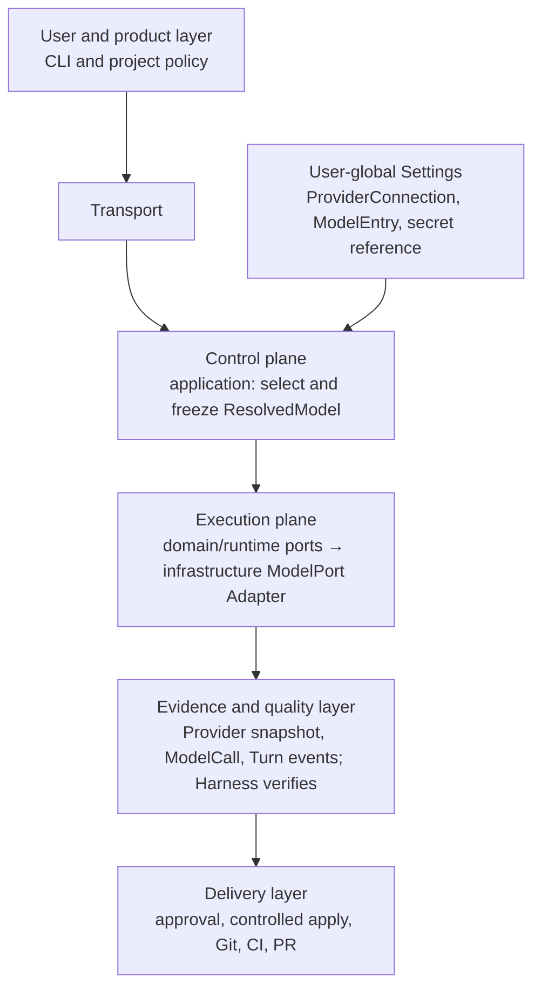

> **历史决策适用说明 — 文档整理：2026-09-07。** 保留当时决策及理由；accepted 不表示所有实现完成，也不覆盖新的产品范围。与 [V2 提案](../superpowers/specs/2026-09-07-yipilot-v2-architecture.md) 不同的实现按迁移方案处理，现状查 [状态页](../product/status.md)。

# ADR: model selection control plane and Run freeze

**Status:** Accepted not implemented\
**Date:** 2026-09-01

## System context and impact analysis

Model selection belongs exclusively to the control plane. `ModelPort` is an
execution-plane infrastructure Adapter; `Provider` snapshots, `ModelCall`, and
`Turn` events belong to the evidence and quality layer. Harness consumes
evidence to verify it; it neither reads Settings nor participates in model
selection.

Project configuration may express only non-sensitive allow/default policy. A
user-global Settings store holds `ProviderConnection`, `ModelEntry`, and local
secret references; secrets and their references never enter a project.

M5-A migrates its live `PatchProposal` path by resolving the legacy
`ProviderProfile` at the control-plane boundary, producing and persisting one
redacted `ResolvedModel`, then passing only that frozen value to the existing
`ModelPort` Adapter. Fake/replay retain their immutable recorded identities and
evidence, and existing Run evidence remains readable; neither mode resolves
Settings nor becomes a live-call fallback.

| Stage | Required model-selection output |
| --- | --- |
| M5-B | The frozen `ResolvedModel` and its Run-scoped snapshot while an approved `PatchProposal` is applied. |
| M6 | The same frozen selection, plus its per-`Turn` `ModelCall` and verification evidence for bounded repair. |
| M7 | The Run/Handoff evidence chain, including the frozen selection, for approval, commit, push, and CI correlation. |
| M8 | The traceable Run/Handoff and selection evidence used in the Pull Request summary and read-only review handoff. |

Module dependencies point only in this direction:
`transport → application/control plane → domain/runtime ports → infrastructure`.
`Runtime` must not read Settings or choose a model in reverse; Harness only
verifies evidence and does not participate in selection.

## Context

The current `ProviderProfile` combines a connection and one model. M5-A can
resolve that profile before its proposal-only call, but the next control plane
must support multiple named models and variants without allowing an active Run
to change its identity or endpoint.

Pi Agent and OpenCode provide useful configuration and selection interaction,
but Yipilot's durable Run evidence and approval boundary require a narrower
contract.

## Decision

Resolve a `ModelSelector` in the control plane before creating a live Run. The
result is one immutable `ResolvedModel`; persist its redacted snapshot as Run
evidence before the first model request. The Run consumes only that frozen
value. It must not reread settings or switch `ProviderConnection`, model,
variant, endpoint, or configuration revision while it is active.

The selector is exact `connection_id/model_id`, optionally followed by
`:variant`. Resolution priority is exact per-Run `--model`, then an explicitly
selected interactive-session selector, then the user's global default selector,
then failure. The session selector exists only in the terminal process and is
not persisted; it affects only a Run created after the choice. There is no
project default in this stage.

`ProviderConnection` is separate from `ModelEntry`; a `ModelVariant` is a
named override of the same model, not another Provider. Credentials remain
local references to user-local `auth.json` or an environment variable. A
key, and its reference, are excluded from projects, Runs, Artifacts, events,
command lines, and configuration snapshots.

Do not implement active-Run model switching, automatic fallback, fuzzy
matching, dynamic discovery, OAuth, or steering. An interactive-session choice
may select the model for a future Run, but it cannot alter an existing Run. A
transport or Provider failure ends the Run conservatively; it does not select
another model.

## Consequences

- A Run is reproducible and auditable even when a user changes the default or
  edits a connection immediately after it starts.
- `settings model configure`, `list`, `select`, and `test`, plus an
  interactive `/model` session selector, can offer a Pi- or OpenCode-like
  experience without importing their runtime or catalog policy.
- M5-A's live PatchProposal path must receive its endpoint, limits, model and
  variant options from `ResolvedModel`, not load mutable provider settings.
- Fake and replay stay deterministic offline adapters. They never become a
  fallback for a failed live request.
- The profile-shaped `providers.json` needs a deliberate, lossless migration
  before M5-A adopts this control plane.

## Alternatives rejected

**Pi-style switching during an active Run.** It makes one Run contain multiple
provider identities and configuration revisions, weakening the evidence needed
to explain a patch proposal. Selecting a model in an idle interactive session
for a later Run is allowed because the selected value is still frozen before
that Run begins.

**Automatic fallback.** A successful-looking proposal could come from an
unrequested endpoint or model. It hides cost, data-routing, and behavior
changes exactly where Yipilot must be explicit.

**Choose the first available model or fuzzy-match an ID.** Both make the same
command resolve differently as local configuration changes. Exact selection is
smaller and safer.
