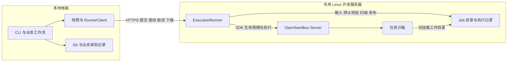

# OpenSandbox 接入路线的整体复杂度复核

日期：2026-10-19。本稿主体为A/B/C架构候选讨论；第10节另记录用户授权后的服务器检查、基础安装和单沙箱验证，不代表Runner已实现或整体迁移完成。未修改应用、vision或roadmap。第三方事实固定引用已核对源码；A/B/C的成本与建议属于设计推论。

本轮请求后的详细工作顺序、代码整合范围与用户下一步见[远程迁移实施安排](2026-10-19-opensandbox-implementation-plan.md)。该计划仍为 Proposed，不把候选接口或容量目标写成已实现能力。

2026-10-20 已授权开展第一阶段；基线修复、非 root/只读/禁出网的组合探针、剩余隔离缺口见[第一阶段验证记录](2026-10-20-opensandbox-phase1-validation.md)。组合可行性不等于已安装正式 profile 或实现 Runner。

## 1. 判断

在“业务、审批、Git worktree 继续在本机，远端长期承担执行”这个前提下，**B 值得优先设计，整体上可比 A 更集中**：把执行状态、临时目录、停止核验和结果扫描放到同一远端可信进程，省去 collector、跨沙箱卷交接和对本地开放的 SSH 管理协议。但 B 必须是负责完整执行生命周期的 Job Runner，若只把 HTTP 转发到 SDK，反而多了一跳。

若业务和仓库都可上服务器，C 的执行边界更少，应一并考虑；它把问题改为“远端完整产品如何部署、访问和运维”。没有必要仅为保留旧模块形状选择 A，也不应仅为微服务形式选择 B。

## 2. 三路线比较（设计推论）

| 路线 | 本地/远端责任 | 主要收益 | 新增与长期负担 | 适合条件 |
|---|---|---|---|---|
| A：本地控制，SDK task/collector，SSH 维护 | 本地同时协调 OpenSandbox、维护工具、卷和 collector | 业务保持本地；复用既有 SDK 数据面 | 任务与 collector 两套生命周期，卷交接、停机核验、SSH 窄协议、残留回收；故障步骤分散 | 已有成熟远端管理工具，或暂时不愿维护常驻 Runner |
| B：本地业务，远端单进程 Runner | 本地管业务/批准/应用；Runner 管 job、输入/工作目录、OpenSandbox 调用、停止/扫描/产物 | 执行权、文件和恢复责任同机；只暴露 job/artifact 接口，无 collector/外露 SSH 交接 | 新增受认证 HTTP、耐久 Job 表、上传/下载限制和 Runner 运维；必须划清两端账本 | 本地仓库/业务是明确需求，远端执行要反复使用 |
| C：整个 YiPilot backend 上服务器，本地 UI/CLI | 远端业务、Git、DB、Runner/worker、OpenSandbox；本地仅客户端 | 可复用同机执行/扫描，少一次业务与执行账本同步 | 后端远程化、仓库迁移、模型/Git凭据、备份、认证和UI/CLI通信；本地原仓库如何使用需另定 | 接受服务器成为工作区与业务状态权威，计划多设备/多人访问 |

A 看似少写一个 HTTP 服务，却仍要实现远端 prepare/inspect/release/GC 协议和 collector 状态；这部分不是免费。B 也不会消灭恢复逻辑，只是将其收拢到离 Docker 和目录最近的可信执行主体。

## 3. B 怎样才不是浅代理

最小 Runner 可以是单进程、一个 SQLite、一个受限目录根、有限并发执行器；暂不需要 Redis、独立调度平台、HA、分布式队列或通用远程 shell。它可以仍位于 YiPilot 同一仓库/发行包中，单独启动为远端角色，无需先拆成另一个产品。

- **接收业务无关的 ExecutionJob：** 上传完整受限快照、固定请求合同和内容 hash；成功接受前原子记录输入、job_id、request key。查询/取消/下载以此 ID 为准，不给本地暴露裸 Docker/OpenSandbox 控制权。
- **拥有真实生命周期：** Runner 登记 attempt 与 sandbox ID，设置运行/输出预算，负责停止、实际容器/sidecar核验、隔离目录及到期回收。HTTP 客户端断开不代表取消或重跑任务。
- **停止后扫描同机 bind：** task 只能写 Run 工作目录；Runner 仍须证明其他写入者退出并禁止重新挂载。之后用可信扫描器生成完整 manifest，将结果复制/打包到任务不可写的独立 artifact 区，下载只读 artifact；不要直接把不断变化的工作目录当静态结果接口。
- **拥有崩溃恢复：** Runner 重启扫描自身 Job 表与实际运行时，处理 create 已发生但响应丢失、执行结局未知、kill/remove失败、扫描中断、产物未发布和GC失败。接受请求去重可以实现，不能宣称远端副作用 exactly-once。
- **独立于连接的查询：** HTTP 提交、状态、取消、artifact下载是少数窄接口；长命令无需依赖一条持续连接。身份/项目授权、快照路径/链接/大小限制、超时和下载hash属于该接口基本合同。

本地 Run 账本记录业务意图、批准与应用；远端 Job 账本记录已接受输入、执行 attempt 和不可变结果。这是两种权威，不应把同一个 workflow 状态机在两边双写。若 Runner 又决定批准、repair 策略、Git apply，而本地也决定一遍，B 就扩成了半套重复后端，应删掉重叠或直接选 C。

## 4. 已核对项目支持哪部分借鉴（事实）

- **DeerFlow：** SandboxMiddleware 决定懒/主动 acquire，并处理执行 lease/release；OpenSandboxProvider 管 user/thread scope 的实例、创建、复用、输出同步、warm pool 和 shutdown；OpenSandboxSandbox 包装 SDK。其 release 在沙箱仍存活时做有界 best-effort 输出镜像，然后进入 warm pool，shutdown 才 destroy。说明“框架流程 → 生命周期所有者 → SDK adapter”的分层真实存在；**没有据此证明其实现 B 的 HTTP Job Runner、SQLite执行账本或可信停止后不可变导出**。[middleware](https://github.com/bytedance/deer-flow/blob/afc96c667a11e40214b64206e96e976bdd77127b/backend/packages/harness/deerflow/sandbox/middleware.py#L55)、[provider](https://github.com/bytedance/deer-flow/blob/afc96c667a11e40214b64206e96e976bdd77127b/backend/packages/harness/deerflow/community/opensandbox/provider.py#L367)、[SDK wrapper](https://github.com/bytedance/deer-flow/blob/afc96c667a11e40214b64206e96e976bdd77127b/backend/packages/harness/deerflow/community/opensandbox/sandbox.py)
- **AgentScope 主仓：** Backend 提供命令/文件原语，Workspace 管 create/connect/resume，Manager 管 workspace_id 缓存和 idle eviction；close 是 pause+local close，偏重持久工作区。可借鉴生命周期所有权与工具分离，不能直接复制其暂停/重连语义作为一次性 job 的清理证明。[Backend](https://github.com/agentscope-ai/agentscope/blob/f2bedf3e5e3b7b3425d41d49b59af131fcd18cbe/src/agentscope/workspace/_opensandbox/_opensandbox_backend.py)、[Workspace](https://github.com/agentscope-ai/agentscope/blob/f2bedf3e5e3b7b3425d41d49b59af131fcd18cbe/src/agentscope/workspace/_opensandbox/_opensandbox_workspace.py#L147)、[Manager](https://github.com/agentscope-ai/agentscope/blob/f2bedf3e5e3b7b3425d41d49b59af131fcd18cbe/src/agentscope/app/workspace_manager/_opensandbox_workspace_manager.py)
- **Ayush DeepAgents adapter：** 仅接收已有 SandboxSync，执行/文件工具不负责创建销毁，证明接入框架无需将生命周期散入每个工具。这是 adapter 形状，不是可靠远程执行服务的完整参考实现。[固定源码](https://github.com/AyushSonuu/langchain-sandbox-opensandbox/blob/c0ac09f57397f2dbe80b0c40ad5ee37799f90d57/langchain_opensandbox/sandbox.py#L29)
- **OpenSandbox 固定版：** Docker host bind、主容器 delete 和 sidecar best-effort cleanup 已存在；lifecycle 提供 sandbox 管理，未提供 YiPilot Job 状态机或可信完整目录导出。因此 B 让 Runner 承担这些缺口是本项目设计选择，不是上游已有产品能力。[volumes](https://github.com/opensandbox-group/OpenSandbox/blob/531700ca18a7fa5fab6a2f25d6dc68a76eddab12/server/opensandbox_server/services/docker/volumes.py)、[delete](https://github.com/opensandbox-group/OpenSandbox/blob/531700ca18a7fa5fab6a2f25d6dc68a76eddab12/server/opensandbox_server/services/docker/docker_service.py#L1111)、[sidecar cleanup](https://github.com/opensandbox-group/OpenSandbox/blob/531700ca18a7fa5fab6a2f25d6dc68a76eddab12/server/opensandbox_server/services/docker/networking.py#L414)、[lifecycle API](https://github.com/opensandbox-group/OpenSandbox/blob/531700ca18a7fa5fab6a2f25d6dc68a76eddab12/specs/sandbox-lifecycle.yml)

## 5. 可简化与不可省去的部分（建议）

可以换掉旧 DockerWorker、旧证据字段和文件搬运实现；没有必要保留 collector/SSH 仅为兼容上一版计划。B 首版可只面向一个远端 Docker host、一个 Runner 进程，单部署配置和显式并发上限，不提前做 Kubernetes。

不能省去输入身份与完整性、隔离和资源限制、禁越权管理面、输出边界、可信停止、稳定结果、崩溃对账及残留回收。这些是承担不可信代码的执行职责，可以重设计合同和位置，不应通过把失败当成功或删除未知状态来“减少代码”。Runner 与 Docker 同机意味着它是可信控制面；迁移到 B/C 本身不会修复此前发现的 execd 管理面/身份问题。

建议呈现给用户的是：**保留本地业务选 B；愿意让服务器成为整个工作区权威则比较 C；A 作为有现成运维约束时的备选。** 目前授权是方案讨论，应先把运行位置、状态权威与输入/结果合同做成可审查设计，再决定实现与部署。

## 6. 推荐 B 的具体形态（Proposed）

推荐前提：本地仓库与业务交互仍重要，同时预计反复使用远端沙箱。B 将执行职责移到服务器，而不要求先将所有模型、需求设计、审批和 Git 发布逻辑远端化；若目标是本地关机后整个研发流程仍自动推进，应选择/评估 C。



OpenSandbox Server 与 Docker 使用内部/本机入口，只由 Runner 持有管理凭据。用户端只访问 Runner；SSH 用于部署和运维，不进入每次 Job 协议。Server/execd/runtime 分工依据[官方架构](https://github.com/opensandbox-group/OpenSandbox/blob/main/docs/architecture/index.md)，具体 Runner Job 协议是本项目拟新增的合同。

### 6.1 同机目录代替跨沙箱数据卷交接

首版在同一 Linux 主机运行 Runner、OpenSandbox Server 和 Docker；Runner 原生进程先落地。若以后把 Runner 放容器内，必须验证它与 daemon 的绝对路径映射和实际内容一致，不能把容器内路径直接当宿主 bind。

```text
/srv/yipilot-runner/
  state.db
  jobs/<job_id>/
    input/       # 可信接收的冻结输入，任务不可写
    work/        # 唯一挂给任务沙箱的目录
    artifacts/   # 停止核验后发布的结果，任务不可访问
```

流程：收到完整输入 → 验证并发布 input → 复制 work → OpenSandbox 将 work 挂 /workspace → 执行 → destroy 并核查实际 writer/sidecar → 可信扫描 work → 向 artifacts 发布完整结果 → 客户端下载 → 按保留策略清理。首次可全部使用主机目录，不引入 named-volume 所有权交接、collector 镜像或客户端 SSH 管理工具。

任务只挂 work，禁止挂 input/artifacts/DB、Runner 代码、凭据、Docker socket。Runner 不在宿主运行仓库代码，也不从 work 导入 Python 配置/插件；扫描器及结果打包程序来自可信制品。OpenSandbox host bind 有允许路径校验，但逐 Job 归属、实际停止与目录回收属于 Runner 自己的职责。[固定 host bind 实现](https://github.com/opensandbox-group/OpenSandbox/blob/531700ca18a7fa5fab6a2f25d6dc68a76eddab12/server/opensandbox_server/services/docker/volumes.py#L96)

### 6.2 本地只需要窄 Job Interface

下面是拟新增 HTTP 路径，不是当前产品可用接口：

| 请求 | 合同 |
| --- | --- |
| POST /v1/jobs | 提交 execution spec、输入 manifest 与完整输入包；服务端校验、耐久接受后返回 job_id |
| GET /v1/jobs/{id} | 查询状态、执行结果摘要、固定输入/结果 digest、是否待清理 |
| GET /v1/jobs/{id}/events | 按序号读取进度与有界日志；可 SSE，重连按 cursor 查询，不重启任务 |
| POST /v1/jobs/{id}/cancel | 请求停止已关联的执行；返回请求已收到不等于已停止，最终以观察结果为准 |
| GET /v1/jobs/{id}/result | 获取已完整发布的结果包；未发布返回明确未就绪，不流式暴露正在变化的 work |

Job 是一次隔离执行阶段，不是每一次文件读取；输入合同包括 request_key、输入 digest、执行计划、预算和允许的运行 profile。客户端不能直接选择宿主路径或调用任意管理操作。命令可执行范围由已授权 profile 决定；HTTP handler 不能把请求拼成宿主 shell。

本地已有 httpx 可以用于 RunnerClient。SDK、Docker 运行时观察、工作目录收尾集中在服务器角色。Runner 可留在同一仓库/发行体系，服务依赖作为显式可选依赖管理，不把上游 opensandbox-server 私有路由改成项目 Job 入口，也不默认维护上游 fork。

### 6.3 状态、完整性与断线合同

- 本地 Task/Run 负责需求版本、批准、候选版本和应用结果；只持有远端 job_ref、输入 digest 和已下载结果引用。远端 ExecutionJob 是执行进度/attempt/产物的唯一权威。两端可以记录不同事实，不能独立决定同一执行状态后互相覆盖。
- 请求 key 与请求内容摘要在 Runner SQLite 中唯一绑定：相同 key + 相同输入返回同一个 Job，不同内容明确冲突。SDK create/command 本身不被假设为幂等。
- 文件与 SQLite 不是一个跨介质原子事务：先有界接收并验证输入到临时目录，原子发布完整文件，再事务记录 Job 接受；完成前不执行。崩溃遗留的未引用目录可以精确 GC；返回已接受必须意味着输入和 Job 记录可恢复。
- 已接受 Job 可脱离本地 HTTP 连接运行；这要求服务器 Runner 和资源保持可用。Runner 重启先对账之前 active Job，结局未知则停止/记录 uncertain，不自动重放命令。客户端重新连接可查询同一 Job，但本地剩余业务流程要等 YiPilot 恢复才能推进。
- 产物在真实停止核验后发布，包含 request/input/output digest、完整路径/文件大小/hash/Git mode、日志及运行/清理事实。客户端从安全 staging 重新计算字节与完整性；完整清单识别删除，不能直接覆盖用户主工作区。
- 上传/下载包必须有路径、链接/特殊文件、数量、单文件/总量和解压后大小限制；不能直接 extractall。输入不完整不得启动，结果不完整不得交付。先全量快照与结果包，不增量同步、不建 CAS 服务。
- Job 完成只表明执行/采集合同已完成；测试是否通过仍由明确 exit/outcome 与业务验证政策判定。cleanup_pending、未知终态或不完整证据不得被普通 HTTP 200 隐藏。

## 7. 代码整合与最小验收范围（建议）

- 本地重写执行调用为 RunnerClient，工作流只知道 Job 合同；删除本地 Docker CLI、OpenSandbox 对象、卷与 collector 编排，不为旧字段写大量伪适配值。
- 服务器整合执行预算、取消、SDK 生命周期、运行时观察、停止、可信扫描、结果发布与清理。源码路径/manifest/审批的有效规则可以作为共享纯合同复用；旧 Docker Result schema、JSON 文件布局与类名可以重做。
- 每种执行记录只保留一个所有者；现有验证/repair/审批步骤可按更清楚的快照合同重组，不要求原样保留 service 拆分或逐方法调用顺序。安全与版本绑定能力须有新的等价验收，不能用架构重写代替。
- 首版一个 Runner 进程、SQLite、目录和显式并发限制；不加入 Redis、分布式队列、对象存储、预热池、多租户或 HA。部署增加一个自有 Runner，必须计入总代码、依赖、运维和故障处理成本；本轮没有实测这些净成本。
- POC 先证明提交同一 Job 不重复执行、客户端断线后已接受任务可继续、服务器重启不重放未知命令、取消与清理准确、稳定结果完整下载，以及本地项目受保护。再迁移 apply/验证和实际模型工作流。

这比 A 多一个长期服务，但能删除 A 的跨机细粒度编排；若 POC 表明 Runner 只是透传或新增大批重复状态，则缩小/合并职责，不能因已画图就默认架构更优。

## 8. Kubernetes 与产品范围

B 可让本地 Job Interface 保持稳定，但单机直接读取 host bind 的实现不适用于任意 K8s 节点。未来必须重新设计共享存储/节点侧采集、访问权限和清理，不能承诺只改 endpoint。C 同样有这项运行时存储问题。

当前产品定义仍将本地运行与不建设服务端列为既有范围。本轮用户明确允许讨论替代接入方式，支持研究 B/C，但没有确认采用其中任何一条；本稿不修改 vision、roadmap 或声称已改变产品部署方式。A 详案作为特定前提的备选保留，见[本地 SDK 编排候选](2026-10-19-opensandbox-remote-execution-design.md)。

## 9. 单服务器多任务并发目标（Proposed）

用户已明确希望按更高并发设计，不把 1 个任务作为正式容量目标。**首版按最多 8 个运行沙箱的可调能力设计，以 4、8 两档做实际负载验收；实际启用额度由服务器规格与任务预算决定。** 8 是设计/压测目标，不是未知硬件上的容量承诺。Job 接收/排队数、模型调用并发与运行沙箱数分别计量，不能全部混称为并发。

- **同一台主机多个 Job：** 每个 Job 有独立输入、work、artifact 根和沙箱；排队/模型等待不占运行沙箱槽。应用阶段、pytest/Ruff/mypy 等子执行共用主机的全局沙箱额度，不能外层开 8 个 Job、内层再各起 3 个而绕过额度。
- **按预算准入：** 同时满足配置槽位、可分配 CPU、可分配内存和磁盘条件才启动。内存预算要计入 task、sidecar、传输/扫描开销，为 Runner/OpenSandbox/OS 留余量；重构建用较大预算，可并行数自然较少。CPU quota 是使用上限，不是实际保留核心；低瞬时利用率不意味着可以无限接纳同时到峰的任务。[Docker 资源限制](https://docs.docker.com/engine/containers/resource_constraints/)
- **小型实现：** 单进程 Runner 用有界并发控制加 SQLite queued Job 记录即可；原子声明执行所有权后才启动，重启核对实际沙箱重建容量账。只有实际写入者停止且资源释放已确认才归还相关额度；清理失败不能先释放名额再不断创建新沙箱。采集、打包与传输同样要有界。
- **同仓库任务也能并行：** 使用各自冻结快照和隔离工作副本；同一目标分支的最终应用/发布串行提交并复核 base/candidate，前一任务改变基线时，后一任务必须核对/重新验证。并行编码不是允许两个任务同时改同一正式工作目录。
- **需要改现有锁的作用范围：** 当前 exclusive_execution 用 project executor 锁包住整个 service 方法，会把同项目长任务串行化。新设计改为 Run/Job 执行所有权，以及共享项目配置/最终写入的短临界区；远程运行与网络等待不长期占项目锁。迁移/全局配置操作仍须协调并排空在途任务，不能简单删除所有锁。[当前实现](../../src/yipilot/persistence/ownership.py)
- **验收看实际收益：** 4、8 两档混合普通测试与重任务，记录单位时间完成量、等待、任务耗时、峰值内存、CPU/磁盘争用及清理残留；验证超时、取消和重启不会重复执行或超额创建。达不到收益时调整每 Job 预算/额度，不预先引入 Redis、分布式队列或 K8s。

服务器规格现已由用户补充，见第10节；第10.4记录了基础安装与单沙箱验证。主要任务负载、全局沙箱额度与并发容量仍未验收，本节是调度设计目标。

## 10. 已取得的华为云 Flexus 节点（2026-10-19，用户提供）

用户提供规格：2 vCPU、2 GiB RAM、40 GiB系统盘、Ubuntu 22.04、弹性公网IP峰值2 Mbps、流量包100 GB。现已通过SSH确认系统、资源与root登录权限，实测见10.3节；区域、确切Flexus子产品、安全组规则和计费项尚未通过云控制台/API核查。免费服务器名单转为背景参考，本轮不继续替用户申请其他资源。

**定位：单机开发/POC节点，先验证完整远程执行链路；按用户意愿把4个轻量活跃沙箱作为本节点压测目标，依次验证1、2、4个，不预先承诺4个通过。** 多任务调度仍可配置至后续4–8档，但实际启用额度由主机余量与任务预算决定；排队/本地模型调用与正在运行的沙箱分别计量。完整测试/构建不因目标并发而缩减既有执行预算。

| 项目 | 这台机器的首轮安排 |
| --- | --- |
| 控制进程 | 原生单进程Runner + 单进程OpenSandbox Server + Docker；模型、Git主仓库和业务工作流在本地 |
| 资源准入 | 先测OS/Docker/控制进程/execd/egress的实际峰值，给宿主保留余量后再决定task预算；单沙箱fixture可从512 MiB试起，4轻量档的256 MiB只是待测profile，不能当作实际占用或默认生产预算 |
| 正式验证预算 | 现有验证请求约1 GiB；不能无声降为512 MiB后沿用旧审批/声称等价验收。若机器无法同时容纳该预算及管理余量，应排队或明确资源不足 |
| 镜像 | 固定版本的轻量Python工具镜像；构建尽量在本地/CI完成，服务器拉取固定digest；先不部署浏览器/桌面、本地大模型或大体积全功能镜像 |
| 磁盘 | 检查实际可用空间及镜像展开空间；可把剩余5 GiB作为初始拒收水位候选，按实际镜像调整。按Job所有权回收过期产物/临时目录，不全局prune用户数据 |
| 网络入口 | 开发期可用SSH端口转发访问仅本机监听的Runner，再验收正式HTTPS；SSH只传输/运维，不恢复候选A的远端卷管理协议 |
| 并发扩展 | 4/8仍是后续可调能力与压测目标；这台节点的生效额度由内存和CPU预算决定，不能靠排队数伪装活跃并发 |

用户规格与官方Flexus L通用套餐相符，但尚未登录确认子产品。若确为该套餐，2 Mbps是出网峰值；低于等于10 Mbps的出网档位入网峰值为10 Mbps；100 GB对应按周期重置的出网流量包，超额计费。峰值是上限参考而非保证。以其实际区域与实例确认页为准。[华为云实例规格](https://support.huaweicloud.com/productdesc-flexusl/pd_01_0003.html)

### 10.1 根据2 Mbps出网调整结果传输

2 Mbps按十进制换算理想约0.25 MB/s；100 MB回传至少约400秒，即6分40秒，实际还受峰值争用和协议开销影响。因此完整源码树每轮原样回传的设计应调整为：

- 每个Job上传并固定输入快照，服务器保留它；退出后可信扫描完整结果清单。
- 结果包包含完整output manifest、增改文件bytes、明确删除项和Git mode；本地用已保存的相同输入快照重建新staging，再重算完整树/hash。未修改文件可从本地冻结输入复制，不能从后来已变化的用户工作目录取。
- 每次Job独立计算变更；不增加跨Job增量同步、CAS或对象存储。压缩包读取仍须限制路径、链接、数量及解压后大小。
- 日志有界保存/传输，下载期限按包大小与链路单独计算；运行命令的期限和结果下载期限分开，不能把慢回传误判成命令应重跑。

这里明确修订第6节“首版全量结果包”的选择；完整文件清单和本地字节验证仍保留，传输只省去已有且已核对的未改动字节。采集/停止/完整性门槛没有因低带宽省略。

### 10.2 只读检查进度

已核对真实架构/系统、Python版本、可用内存/磁盘、监听端口、Docker/cgroup与SSH。待核对云安全组、镜像仓库可达性和实际上下行。Docker官方仍支持Ubuntu22.04，华为云亦提供该系统的Docker部署说明；这只证明有部署路径，不是本实例已就绪。[Docker支持](https://docs.docker.com/engine/install/ubuntu/)、[华为部署说明](https://support.huaweicloud.com/bestpractice-flexusl/flexusl_bp_0046.html)

本机已生成独立SSH密钥并限制私钥文件访问权限，备份原config后追加huawei-opensandbox别名。用户在华为云终端添加公钥并提供ED25519主机指纹；本机SSH逐字匹配后保存主机公钥，严格校验主机身份和非交互密钥登录均成功。未在仓库保存密钥内容。

### 10.3 已连接主机的实测基线（2026-10-19 19:07，北京时间）

以下是SSH只读检查的一次采样，不是压测结果；空闲内存会随后台进程变化。

| 项目 | 观察结果 |
| --- | --- |
| 主机/架构 | hcss-ecs-ccf9，x86_64，2 vCPU |
| 系统/内核 | Ubuntu 22.04.5 LTS，5.15.0-186-generic |
| 操作系统可见内存 | 1771.2 MiB，约1.73 GiB |
| MemAvailable | 1269.1 MiB，约1.24 GiB |
| swap | 未配置 |
| 根文件系统 | 总量39.26 GiB，已用4.16 GiB，可用33.38 GiB |
| Python | 3.10.12；未找到python3.11/python3.12/uv |
| Docker/containerd | 未安装，服务未运行 |
| cgroup | v2，包含cpu、memory、pids等控制器；实际容器资源限制仍待安装后核验 |
| TCP监听 | SSH监听22；另有本机回环监听；ufw当前inactive，云安全组尚未查询 |

容量含义：4×256 MiB等于1024 MiB，仅从这次MemAvailable扣除四份沙箱预算后约剩245 MiB；这还没有安装Docker、OpenSandbox Server和Runner，也没有计入预算外sidecar与采集/传输峰值。256 MiB能否容纳execd和具体任务同样未知。因此不能现在就把4设为已验收运行额度，也不能把4×512 MiB配置给实际可见内存不足2 GiB的主机。

该段为安装前基线。最小控制栈与单沙箱验证现已完成，见10.4；后续按1→2→4档执行同一轻量fixture，记录主机/容器内存峰值、OOM、任务耗时、控制面响应和清理结果，预算准入不足时排队。系统Python 3.10主版本保留，项目Runner所需>=3.11仍待独立运行环境。开发期管理服务仅监听回环地址，经SSH转发接入。

### 10.4 基础安装与单沙箱已验证（2026-10-19 19:37，北京时间）

用户授权后，已安装Docker 29.1.3及独立环境中的OpenSandbox Server/SDK 1.1.1。服务由systemd管理，仅监听127.0.0.1:8080；已启用API密钥，沙箱发布端口同样限定回环。execd最终使用官方1.1.1 BOM摘要，已验证argv Python命令、文件往返、非零退出码、0.5 CPU/512 MiB实际限额和销毁后零容器残留；本地SSH转发健康/认证验证也通过。

安装后一次空闲采样：MemAvailable 1051.4 MiB，OpenSandbox service MemoryCurrent 137.4 MiB，磁盘可用32.21 GiB，无swap。完整步骤、版本差异、服务器文件与管理命令见[安装记录](2026-10-19-opensandbox-server-installation.md)。

当前容器仍为root、rootfs可写、bridge尚未设置deny出网；只执行了受信fixture，不能视为现有隔离合同的等价迁移。尚未安装Runner、修改YiPilot应用代码、实现预算队列或执行2/4并发压测。API并发限制不等于沙箱槽位；下一阶段先完成运行profile与隔离验收，再开展容量压测和项目接入。
