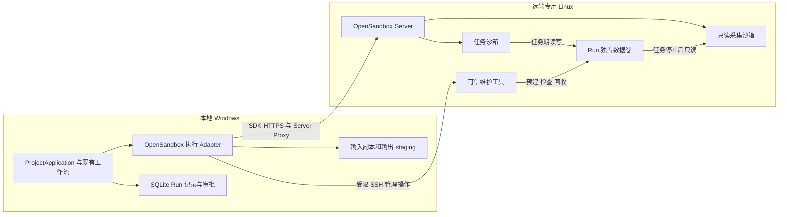

# 本地 YiPilot → 远端 OpenSandbox：执行与文件往返设计

> 日期：2026-10-19（Asia/Shanghai）。状态：Proposed，尚未部署或修改应用。
>
> 范围说明：本文件是“本地直接编排 SDK、远端卷与 collector”的候选 A，不是必须保留的架构。用户随后明确允许更改既有结构；新的 Runner/整体远端化比较见[接入路线复核](2026-10-19-opensandbox-integration-alternatives-review.md)，目前仍在选型讨论。
> 本轮场景：YiPilot、Git、审批和证据留在本地 Windows，远端 Linux 运行 OpenSandbox + Docker。首版按 Run 隔离，验收后全量替换旧 DockerWorker。Kubernetes 是后续部署目标，本文件不声称可仅改地址完成迁移。

## 1. 推荐的最小完整方案

**一个本地执行 Adapter、每 Run 一个独占数据卷、任务结束后一个只读采集沙箱，以及受限的远端维护工具。** 业务/文件走 SDK + HTTPS/server_proxy；维护工具只预建卷、检查实际运行时和清理准确归属的资源。保留现有 Run/审批/源码过滤/diff/可信 apply。

上条讨论中的“可信导出”不必实现成一个新的文件 HTTP 服务：OpenSandbox 的命令、文件、沙箱生命周期与跨沙箱卷挂载可以复用；采集器在新沙箱内读原任务卷。但挂载只读不等于原卷已无其他写入者，可信维护仍是必要的一部分。[固定版本卷能力与限制](2026-10-19-opensandbox-remote-volume-options.md)

首版假设：远端为 YiPilot 专用开发实例，只有受信控制端持有生命周期凭据；任务/模型不持有 Server API key、SSH key 或 Docker socket。其他可任意挂同卷的 API 使用者不在该信任模型内。以后多租户时，需要 Server 侧强制卷授权与 writer 排他，不能靠卷名随机或 SSH 工具的锁代替。

## 2. 调用拓扑与职责



命令/文件通过 Server Proxy 转发到对应沙箱的 execd；本地不需要直连动态容器端口。首版明确配置 HTTPS、API key 引用、use_server_proxy=True，并实测代理能持续转发 SSE 和大文件流。[SDK ConnectionConfig](https://github.com/opensandbox-group/OpenSandbox/blob/531700ca18a7fa5fab6a2f25d6dc68a76eddab12/sdks/sandbox/python/src/opensandbox/config/connection.py)

SSH 是维护通道，首版使用系统 ssh 客户端和固定远端命令；服务端可通过专用账号/forced command 只接受严格 schema 的请求。不能拼接用户 shell、不能接受任意路径/镜像/命令，不把 Docker TCP API 对本地或任务直接开放。维护进程的 Docker 权限属于受信管理侧，账号名字和参数校验本身不会把 Docker 权限变成安全沙箱。

## 3. 一次 Run 的严格顺序

| 阶段 | 本地动作 | 远端动作与成功条件 |
| --- | --- | --- |
| 准备 | 复用源码导出，冻结 baseline/input manifest，完成执行审批 | 尚未执行仓库代码；输入严格取当前已批准的 Run 副本 |
| 登记 | 在现有 SQLite 记录 attempt、runtime、request hash 和期限，再发送外部请求 | 维护工具预建并核对带归属标签的独占卷；同名异主或不明旧数据失败 |
| 创建 | SDK create，收到 sandbox ID 后持久化；上传源码前核对运行时事实 | 固定任务镜像；整个 Run 卷 rw 挂 /workspace；只使用预建卷，缺卷失败；实际镜像/UID/权限/资源/网络/挂载不符则先清理并拒绝执行 |
| 上传 | 使用 bytes 接口有界上传完整输入、显式设置 Git mode，校验输入清单 | 不上传 baseline、.git、.env、正式 worktree 或控制证据；实际工作根是 /workspace |
| 执行 | 按已批准 argv、预算执行；记录 command ID、终态和有界日志 | 命令必须有总期限；TTL 覆盖上传、执行、收尾并留清理余量 |
| 停止 | destroy 任务沙箱，保存执行结果 | 维护工具核查主容器、sidecar、实际权限/挂载及其他 writer；未证明停止则不发布结果 |
| 采集 | SDK 创建固定可信 collector，核验实际镜像和只读挂载后下载完整 manifest 与文件 | 同卷 ro 挂固定空数据目录，缺卷不能补建；固定扫描器不执行仓库文件 |
| 接收 | 下载到全新 staging，复核路径/数量/大小/字节/hash/mode/完整性，登记 artifact | 导出根与控制程序分离；采集期间卷不得重新挂 rw |
| 回收 | 本地完整结果已持久化后确认回收；保存 receipt 或待清理状态 | destroy collector，核查无引用，再精确删本 Run 卷；失败留账 |
| 交付 | 本地计算 diff、输出审批、可信 apply；固定验证各用新的子 Run | 任一采集/完整性/所需清理证据失败都不能伪装为成功交付 |

日志在任务销毁前收集；工作树放在独占卷中，所以任务 rootfs 删除不会同时消除结果。collector 是另一个新 sandbox，不是把已暂停的原任务继续拿来读文件。[卷保留与只读挂载事实](2026-10-19-opensandbox-remote-volume-options.md)

## 4. 卷与采集器合同

### 4.1 卷身份与生命周期

- 由可信维护工具 prepare 预建整卷，并登记 project/run/attempt/request-hash/runtime 归属；名称由控制端生成并严格校验。名称和 metadata 只用于关联，真实授权依靠受信管理路径与专用实例。
- task、collector 都显式设置 PVC.create_if_not_exists=False 和 delete_on_sandbox_termination=False；task read_only=False，collector read_only=True。预建卷的最终删除归维护工具，不能寄希望于 collector 的 destroy 自动删卷。
- 首版每 Run 整卷独占，不采用共享大卷 + subPath；不同验证子 Run 分配不同卷。卷被删除/身份不符时应失败，不能新建空卷后把空结果当作合法删除全部文件。
- 同一 attempt 在 collecting 后不得再创建 rw 挂载；专用控制端的持久阶段检查、项目执行锁与维护核验共同保证正常请求不重入。维护工具无法拦截绕过它的其他 Server API 调用；一旦有其他不受信调用方，必须增加服务端准入约束再启用。
- 卷写入配额是单独运维问题；Docker 不把 PVC.storage 当磁盘硬限额。POC 要核查可用空间、失败回收和保留窗口，正式接入前明确实际磁盘限制，不能把输出扫描 128 MiB 上限当写入配额。

上游只实现挂载/部分自动生命周期，并无独立的 volume/attachment 管理接口；预建归属标签、严格排他与精确 GC 是本设计拟新增的 YiPilot 能力。[上游 schema 和实现核对](2026-10-19-opensandbox-remote-volume-options.md)

### 4.2 collector 只解释数据

- 固定 image digest、entrypoint 和扫描程序；任务卷仅挂数据目录，例如 /run-data，不能覆盖解释器、scanner、execd、配置或导出目录。
- 镜像挂载点预置为空；验证空卷挂载不会触发镜像内容复制或改变原卷。非 root UID/GID 和读权限需实测，不能以 root/特权运行仓库程序来绕开权限问题。
- scanner 复用现有路径/普通文件/链接/预算/UTF-8 规则，生成完整清单；程序和依赖来自可信制品，不从工作目录导入模块、配置或插件。
- 首版下载完整合法文件树，使用 bytes 或有界字节流；不引入压缩包解压、对象存储、增量同步协议或远端 Git 凭据。固定输入规模下先验证正确性，再按实测性能决定是否优化。
- manifest 写到 collector 的独立受控目录，至少含 task/operation/run/attempt、runtime、request/input hash、卷关联、每文件 path/size/sha256/git_mode 和总量；本地从文件 bytes 重算，不能只相信 JSON 中的 hash。
- 完整清单与 baseline 比较识别删除；漏文件、扫描失败、链接/特殊文件、大小写别名和超限都使本次输出失败，不采用“跳过不合法文件后继续成功”。

沿用当前来源上限：单文件 16 MiB、全树 128 MiB、最多 10,000 文件；不为远端传输放宽源文件合同。采集器的独立清单和稳定读取属于新增实现，不是 SDK 已提供的安全全树导出功能。[现有扫描器](../../src/yipilot/workspace/sandbox_sources.py)

### 4.3 Windows/Linux 的 mode 与路径

输入 Git mode 应显式传给远端，输出 Linux 100644/100755 由可信 collector 清单携带。本地 Windows 的 chmod/stat 不能证明 Linux mode；现有 scanner 在 Windows 沿用 frozen_files 的 mode，迁移时必须支持已绑定的远端 mode 事实，否则 chmod-only 修改可能丢失。实际 bytes/hash/路径仍在本地独立验证，模式只接受 Git 合同允许值。[scan_source_tree](../../src/yipilot/workspace/sandbox_sources.py)、[apply 的 index/mode 核验](../../src/yipilot/workspace/sandbox_apply.py)

本地 execution_directory 仍是本地 staging 位置，不改写成远端 /workspace；远端路径由执行实现固定映射，不允许模型传宿主路径。收取结果后保留精确字节和换行，不把日志脱敏逻辑用于源文件。

## 5. 对上层暴露的 Interface

以下为拟实现 Interface，不是当前可用代码：

```python
class OpenSandboxWorker:
    def execute(self, request: SandboxRequestV2, *, cancel_event=None) -> SandboxResultV2: ...
    def reconcile(self, run_id: str) -> ReconciliationResult: ...
```

execute 内部完成登记、创建、上传、执行、停止、采集、下载与必要回收；上层不用安排 SDK 调用顺序。reconcile 只查询/核对/采集/清理既有 attempt，不重放业务命令。执行后的 receipt 核验集中在同一运行时模块，由已有 output/apply gate 使用，不能让两个调用者继续解析 Docker JSON。

首版只保留 OpenSandbox 一个实时 Adapter，测试通过内部 SDK/维护传输 seam 注入 fake；不为已决定移除的 Docker 实现搭通用多 provider 工厂，也不增加一套与 ProjectApplication 平行的业务入口。同步上层可由 execute 在单次事件循环内拥有 async SDK；每个 sandbox/manager 明确关闭 transport，避免跨 loop 共用 client。总 deadline、取消、callback 输出预算和独立 cleanup deadline 需要实现，不能只设置 ConnectionConfig.request_timeout。

## 6. 持久记录与失败恢复

### 6.1 记录放在哪里

现有 SQLite 是 Run 元数据唯一权威。扩展受类型约束的 Run 执行字段，包含 runtime_id、attempt_id、phase、request/input hash、volume、task/collector sandbox ID、command ID、绝对期限和 cleanup_pending；已有事务和 exclusive_execution 管理更新。不新增远端任务数据库、Redis 或另一份可变 JSON 状态机。远端 label 用来对账，不能代替本地业务状态。

phase 是远端执行进度，可记录在现有 stage.progress 审计事件中；保持 pending/running/succeeded/failed/cancelled 等既有 Run 状态语义。不可变的运行时观察、日志、manifest、导出/清理 receipt 由现有 ArtifactStore 登记并绑定 request hash。新增字段要有缺省和历史读取策略；ProjectRecord 的现有 image setter 会重建整个对象，增加配置后必须一起修正，防止丢失 endpoint/key_ref 等字段。[Run/Project 记录](../../src/yipilot/persistence/task_store.py)、[ArtifactStore](../../src/yipilot/persistence/artifact_store.py)

SandboxRequest/Result 使用新合同读取远端 ID、平台、资源和网络事实；不能把远端事实填成旧 network=none、backend=wsl2 或 Docker container 64hex。旧 v1 证据仅历史可核验，不改写全局 SandboxAssociation 破坏既有 SourceManifest。

### 6.2 每类失败怎么处理

| 失败点 | 后续动作 | 禁止事项 |
| --- | --- | --- |
| prepare/create 响应丢失 | 用已落盘 attempt、维护标签和 SDK metadata 分页对账；有歧义先清理/报未知 | 盲重试 create；把空列表当从未创建 |
| 输入上传失败 | 未开始任务时可在已知专属沙箱重传相同输入并重新核验；有并发/归属疑问则终止重建新 attempt | 在不知命令是否开始时覆盖输入 |
| command SSE 断开/本地关闭 | 记录 EXTERNAL_RESULT_UNCERTAIN，恢复后核对并停止已知任务；只对已有完整结果继续采集 | 自动重跑命令；把断网当远端停止 |
| 下载失败 | 保留受控卷，在相同无写入者条件下重试 collector/文件下载；重新检查清单和 bytes | 重跑原任务来重新生成文件 |
| 输出已接收、本地未确认 | 校验已登记的本地 artifact；完整持久化后再请求回收 | 用不完整临时目录进入 apply |
| destroy/删卷失败 | 保留 cleanup_pending 与准确资源关联，受限 GC 后续重试并核验不存在 | prune 所有卷；宣称无残留 |

SDK 对有副作用创建和命令不得配置盲重试；只读查询/稳定结果下载可有界重试。reconcile 不把失败 Run 自动改成成功，也不复用旧审批启动新任务；新执行按现有规则生成新 Run/审批。原 RecoveryService 的不自动重放规则继续成立，并增加远端资源对账入口。[现有恢复](../../src/yipilot/workflow/recovery_service.py)

## 7. 可信维护工具的最小范围

它是固定服务器命令，尚未实现；首版只需要三类操作：

| 操作 | 输入 | 输出/约束 |
| --- | --- | --- |
| prepare | 严格 Run/attempt/runtime/request 关联 | 预建/核对准确卷与归属标签；重入只允许完全相同绑定，异主/旧内容失败 |
| inspect-release | 已记录的 task/collector ID 与卷关联 | 核查实际权限/镜像/挂载、任务/sidecar 停止和其他引用；返回观察 receipt；不接受任意 shell |
| gc | 已确认本地结果持久化或明确放弃的 attempt | 仅清理归属准确且不活跃的对象与卷，核查无引用再 remove；幂等返回结果 |

具体状态数据继续来自本地 SQLite 和远端实际资源；维护工具不引入第二套工作流或任务队列。它的安装制品、SSH host key 和凭据引用要固定，管理凭据不进入 task 或 collector。需要自动回收断线遗留卷时，按相同所有权/期限规则运行维护 GC；保留窗口、磁盘水位和本地仍在执行的判断必须先定，不能按前缀直接批删。

## 8. 能借鉴什么，哪些不能照搬

| 参考 | 借鉴 | 本项目取舍 |
| --- | --- | --- |
| DeerFlow OpenSandbox Provider | 业务接已有 Interface；SDK 原生文件流、传输预算、临时文件原子发布、同归属串行 | 它的 outputs 镜像是 best effort，且不反映远端删除；YiPilot 用完整清单，任一必需文件失败则拒绝本次结果 |
| GitHub Actions artifact | 每次执行的产物有独立 ID/digest，发布后按固定内容读取 | 借鉴绑定与不可变交付，不接 GitHub artifact 服务；保留 Git mode，避免普通压缩传输丢权限 |
| OpenSandbox PVC/只读卷示例 | 不同沙箱共享同卷及 readOnly 挂载 | “任务 rw → 停止核验 → collector ro”是本项目推导的候选组合，未查到这些示例已实现 YiPilot 全套保证 |

依据：[DeerFlow 实现说明](https://github.com/bytedance/deer-flow/blob/afc96c667a11e40214b64206e96e976bdd77127b/backend/packages/harness/deerflow/community/opensandbox/README.md)、[GitHub Actions artifact](https://github.com/actions/upload-artifact)、[OpenSandbox 卷示例](https://github.com/opensandbox-group/OpenSandbox/blob/531700ca18a7fa5fab6a2f25d6dc68a76eddab12/docs/examples/docker-pvc-volume-mount.md)。更多项目的实际接入证据见[编排调研](2026-10-19-opensandbox-orchestration-patterns.md)。

## 9. 修改到哪些代码

| 范围 | 具体修改 |
| --- | --- |
| domain/sandbox.py | Request/Result v2、attempt/receipt/远端 mode 绑定；历史合同保留 |
| workspace/OpenSandbox 执行实现 | create/upload/run/stop/collect/download/reconcile，私有 SDK 与维护传输；替换 DockerWorker |
| sandbox_sources/output/apply | 复用冻结输入与可信验证；接收安全 staging；新增远端 mode 处理；移除分散 Docker 查询 |
| sandbox_application/verification + app.py | 统一接入执行实现；保持验证每工具独立副本/子 Run和现有审批；完成后删除旧实时执行选择 |
| persistence + RecoveryService + SecretStore | 类型化 Run 关联、配置字段不丢失、远端对账、证据登记、现有凭据引用 |
| 运维制品 | 固定 task/collector 镜像、scanner entrypoint、受限维护命令、TLS/SSH/磁盘与清理策略 |
| 测试/CI/指南 | 运行时合同/失败恢复/真实 Linux 远端 job；迁移后更新真实可用命令；不把设计示例写成已实现指南 |

本轮不进行这些应用修改；已有工作树有大量用户修改，后续实施必须在此基础上精确编辑，不 reset、不整批替换。

## 10. 实施顺序与验收

1. **底层 POC：** 无敏感 fixture，固定版本；完成 named volume 预建、task rw、停止核验、collector ro、下载和精确 GC。先证明权限、只读、空卷不变、缺卷失败。
2. **文件闭环：** 完整树增改删、UTF-8 精确字节与换行、Linux mode、Windows 路径/大小写、链接/特殊文件/预算拒绝。证明本地 manifest 与稳定远端 manifest 一致。
3. **故障闭环：** create 响应丢失、SSE 断开、本地进程终止、collector 创建失败、下载中断、cleanup 失败。证明不自动重放任务，恢复只采集/清理准确归属资源。
4. **接入现有业务：** 先 sandbox_apply，再固定 pytest/Ruff/mypy 独立验证子 Run；审批、diff、trusted apply 与历史读取一起回归。
5. **验收后全量切换：** 移除旧 DockerWorker 实时执行和相关选择分支，保留历史证据读取；更新 status/指南并测量总新增/删除代码与运维成本。

只读 collector 解决稳定导出的组织方式，不替代此前管理面隔离、实际资源/网络策略和身份权限的实测门槛。[先前迁移研究](2026-10-13-opensandbox-migration.md)。若必须大量 fork 才满足门槛，先重新评估整体维护成本；不因本方案已写进文档就开始大规模改造。

本轮未运行外部示例、容器、卷或网络验收。正式接入的最大未决条件是：可信停止/排他、collector 程序不受任务数据影响、以及失败后卷的准确回收；本设计不把源码支持当成这些条件已经通过。
