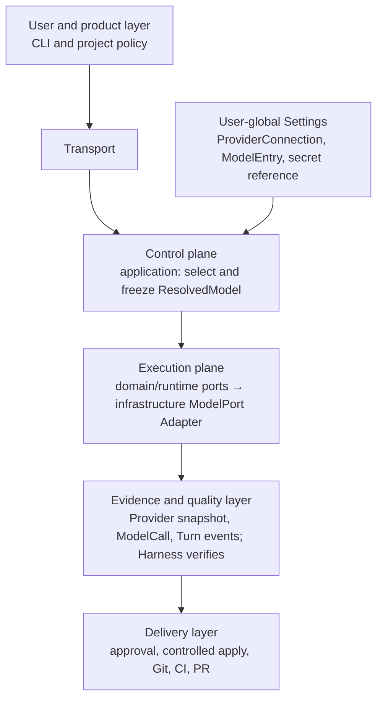

> **Historical reference / Superseded — 文档整理：2026-09-07。** 本文保留旧阶段设计与实施记录，不再作为当前待办或产品范围。当前目标见 [产品定义](../../product/vision.md)，技术设计见 [V2](../specs/2026-09-07-yipilot-v2-architecture.md)，实际能力见 [状态页](../../product/status.md)。下文原状态、强制要求及命令仅在原历史范围内成立。

# Yipilot model-selection control plane

**Status:** Accepted not implemented\
**Date:** 2026-09-01

## System context and impact analysis



Model selection belongs exclusively to the control plane. `ModelPort` is an
execution-plane infrastructure Adapter; `Provider` snapshots, `ModelCall`, and
`Turn` events belong to the evidence and quality layer. Harness consumes
evidence to verify it; it neither reads Settings nor participates in model
selection.

Project configuration may express only non-sensitive allow/default policy. A
user-global Settings store holds `ProviderConnection`, `ModelEntry`, and local
secret references; secrets and their references never enter a project.

M5-A migrates its live `PatchProposal` path by resolving the legacy
`ProviderProfile` at the control-plane boundary, producing and persisting one
redacted `ResolvedModel`, then passing only that frozen value to the existing
`ModelPort` Adapter. Fake/replay retain their immutable recorded identities and
evidence, and existing Run evidence remains readable; neither mode resolves
Settings nor becomes a live-call fallback.

| Stage | Required model-selection output |
| --- | --- |
| M5-B | The frozen `ResolvedModel` and its Run-scoped snapshot while an approved `PatchProposal` is applied. |
| M6 | The same frozen selection, plus its per-`Turn` `ModelCall` and verification evidence for bounded repair. |
| M7 | The Run/Handoff evidence chain, including the frozen selection, for approval, commit, push, and CI correlation. |
| M8 | The traceable Run/Handoff and selection evidence used in the Pull Request summary and read-only review handoff. |

Module dependencies point only in this direction:
`transport → application/control plane → domain/runtime ports → infrastructure`.
`Runtime` must not read Settings or choose a model in reverse; Harness only
verifies evidence and does not participate in selection.

## Purpose and boundary

Define the user-local model-selection control plane for M5. It is a design
task only: it adds no command and changes no current CLI behavior. It adopts
the decision in [the ADR](../../adr/2026-09-01-model-selection-control-plane.md).

Configuration and resolution occur outside `AgentRuntime`. A Run receives one
immutable `ResolvedModel` and cannot change connection, model, variant,
endpoint, capability, limit, or configuration revision after it starts.

## Terms

| Term | Meaning |
| --- | --- |
| `ProviderConnection` | A user-local connection: `connection_id`, type, base URL, capabilities, enablement, transport limits, revision, and credential reference. It is not a model. |
| `ModelEntry` | One exact `model_id` belonging to a connection, with display name, context/output limits, capabilities, and enablement. |
| `ModelSelector` | Stable exact reference: `connection_id/model_id`, optionally `:variant`. The first slash separates a safe connection ID from its model ID. |
| `ModelVariant` | A named configuration difference for the same model, for example `fast` or `high`; it may set supported request options and tighter limits. It is not a copied connection or model. |
| `ResolvedModel` | The result of resolving a selector before Run creation: selector, source, connection/model/variant values, revisions, effective endpoint/options/limits, and a redacted snapshot. |
| `ProviderProfile` | The current transition record that combines one connection and one model. It is not the target domain model. |

Identifiers are exact and case-sensitive. There is no fuzzy matching, alias
lookup, directory lookup, or dynamic model discovery.

## Planned CLI and interactive experience

These commands are future behavior, not commands available today:

```text
yipilot settings model configure
yipilot settings model list
yipilot settings model select connection_id/model_id[:variant]
yipilot settings model test connection_id/model_id[:variant] [--request]
yipilot code generate ... --planner live --model connection_id/model_id[:variant]
```

`configure` is interactive and guides, in order: connection, model, credential
reference, global default, then an optional network probe. It saves a locally
entered key only in user-local `auth.json`, or accepts an environment-variable
reference. A default `test` performs local validation; only explicit `--request`
may make the small fixed probe and sends no project, Run, Artifact, or user
instruction content.

`list` displays only public connection/model metadata and marks the global
default. `select` accepts an exact enabled usable selector and writes the
user-global default. `code generate --model` is a one-Run explicit override.

The terminal application's `/model` command is the ordinary human selection
surface. It keeps an in-memory session selector separate from Settings:

```text
per-Run --model
  > /model session choice (not persisted)
  > user-global default_model_selector
  > fail MODEL_SELECTION_REQUIRED
```

`/model` presents configured models as numbered display choices for their exact
selectors. Choosing one offers `use for this session`, `make the global
default`, or `back`; the display number is never persisted. A session choice
can be cleared to return to the global default. The interactive transport
passes the chosen exact selector and source to the control plane; it never
loads a ModelPort or resolves credentials itself.

## Resolution and failure semantics

Before creating the Operation, Run, worktree, or `ModelPort`, the control plane
does the following:

```text
exact per-Run --model
  > interactive session selector
  > user global default_model_selector
  > fail MODEL_SELECTION_REQUIRED
```

It parses the selector, finds an enabled connection and model, finds an enabled
variant when named, verifies `chat` capability and effective limits, and checks
that the local credential reference is present and readable. It then computes
one `ResolvedModel` from that exact revision. A missing/invalid selector,
connection, model, variant, capability, or credential fails locally with a
specific non-success result such as `MODEL_SELECTOR_INVALID`, `MODEL_NOT_FOUND`,
`MODEL_VARIANT_NOT_FOUND`, `MODEL_DISABLED`, `PROVIDER_DISABLED`,
`PROVIDER_CAPABILITY_UNAVAILABLE`, `SECRET_REF_MISSING`, or
`SECRET_REF_UNREADABLE`.

No Run is created for a resolution failure. Once a Run has begun, transport,
authentication, timeout, rate-limit, or provider errors mark that Run failed
with durable redacted evidence. They never retry with another connection/model,
fall back to fake/replay, or react to a changed default. Project defaults,
automatic selection of a first model, OAuth, steering, and automatic model
switching are out of scope. Changing an interactive session choice or the
global default while a Run is active affects only a later Run; the active Run
keeps its frozen `ResolvedModel`.

## Target user-local persistence

The user settings file is the only persisted configuration location. This is a
format sketch, not an API-key example:

```json
{
  "schema_version": 2,
  "default_model_selector": "qwen/coder",
  "connections": [
    {
      "connection_id": "qwen",
      "type": "openai_compatible",
      "base_url": "https://provider.example/v1",
      "capabilities": ["chat"],
      "enabled": true,
      "timeout_seconds": 60,
      "credential_ref": "env:YIPILOT_QWEN_KEY",
      "revision": 3
    }
  ],
  "models": [
    {
      "connection_id": "qwen",
      "model_id": "coder",
      "display_name": "Coder",
      "context_limit": 32768,
      "output_limit": 4096,
      "capabilities": ["chat"],
      "enabled": true,
      "variants": [
        {"name": "fast", "output_limit": 2048},
        {"name": "high", "output_limit": 4096, "request_options": {"reasoning_effort": "high"}}
      ]
    }
  ]
}
```

`credential_ref` is a local reference, never a key. It is omitted from every
Run Snapshot, Artifact, event, command line, project file, and diagnostic
configuration snapshot. Validation continues to prohibit credentials in base
URLs. Connection edits increment `revision`; model or variant edits must also
advance the effective connection configuration revision so the frozen value is
unambiguous.

## Run Snapshot and M5-A integration

Before the first live call, store a redacted Run-scoped `resolved-model.json`
Artifact. It contains the exact selector and resolution source, connection ID,
type, base URL, connection revision, model ID/display name, effective
capabilities, context/output limits, variant name and allowed request options.
It excludes credentials and credential references.

M5-A live PatchProposal assembly takes the `ResolvedModel` object, constructs
the OpenAI-compatible port from its frozen connection data plus the local
credential lookup, and derives `ModelRequest.model`, endpoint, timeout, output
budget, and variant options from it. It must not reread `providers.json` after
resolution. The existing `provider-profile.json` evidence is replaced by, or
migrated to, this redacted snapshot when M5-A is adapted; no source-writing
authority changes.

Fake/replay do not read user model configuration or make network requests. They
use immutable, recorded fixture identity and response data as their evidence;
they remain deterministic and are never a live-failure fallback.

## Migration from ProviderProfile

The first control-plane implementation reads schema 1 `providers.json` and
migrates it atomically to schema 2 before serving model commands:

1. For each unique `ProviderProfile.name`, create a `ProviderConnection` with
   the same name, type, base URL, capabilities, enabled state, timeout,
   credential reference, and revision.
2. Create one `ModelEntry` from its `model` and `output_budget`; record an
   explicit `context_limit` only when a supported source value exists, otherwise
   leave it unset rather than inventing a provider limit.
3. Convert `default_profile: name` to
   `default_model_selector: name/<profile.model>`.
4. Validate the complete result before replacing the file; retain a timestamped
   local schema-1 backup for recovery. A malformed or conflicting input fails
   closed and leaves the original untouched.

During M5, retain `settings provider add/list/show/use/set-key/test` and
`code generate --provider-profile` as compatibility surfaces. The old profile
argument is normalized to an exact selector only when `--model` is absent; if
both are supplied, fail rather than guessing. After normalization, it occupies
the explicit-selection position in the fixed precedence above and emits a
deprecation warning. Keep it through M5-A and M5-B; remove it no earlier than
the first M6 release after M5-B is complete. New documentation and examples use
only `settings model` and `--model`.

## Scenarios

### A. First DeepSeek-compatible configuration

The user runs future `yipilot settings model configure`, enters connection ID
`deepseek`, an OpenAI-compatible endpoint, and model ID `coder`. They select a
valid local credential reference, choose `deepseek/coder` as their global
default, and decline the optional probe. `settings model list` marks that
selector as default. A later live `code generate` without `--model` resolves
`deepseek/coder`, freezes its redacted snapshot before the Run, and only then
may call the Provider.

### B. Explicit Run override survives a default change

The user's global default is `qwen/coder`. They start a live Run with
`--model deepseek/coder`; resolution records source `explicit` and freezes
`deepseek/coder`. They then select `qwen/coder:high` as the new default. The
active Run continues only with the already-frozen `deepseek/coder` endpoint,
limits, and revision. The new default applies only to a later Run.

## Acceptance criteria

- The target model separates connection, model, selector, variant, and resolved
  snapshot exactly as defined above.
- A live Run has one redacted `ResolvedModel` snapshot before its first request;
  no mutable settings read can change it afterward.
- Exact `--model` beats only the global default; no default produces a local
  failure before Run/worktree/provider work.
- Credentials and references never enter a project, Run, Artifact, event,
  command line, or redacted snapshot.
- Migration preserves every schema-1 profile/model/default without silently
  choosing a different model, and failure preserves the original file.
- Fake/replay deterministic tests prove no live provider call or fallback.
- Tests cover changed-default-during-Run, disabled/missing components, exact
  parsing, legacy-flag conflict, redaction, migration, and M5-A use of only the
  frozen `ResolvedModel`.

## Implementation slices

1. Introduce schema-2 domain/store models, exact parser/resolver, migration,
   and deterministic tests; keep current CLI behavior through adapters.
2. Add the `settings model` CLI commands and deprecation path for profile
   commands/flag; test local validation without a network request.
3. Refactor M5-A live proposal assembly to accept and persist `ResolvedModel`.
4. Implement M5-B's separately approved controlled PatchProposal application;
   it consumes the proposal and its frozen model evidence but does not alter
   model selection.
